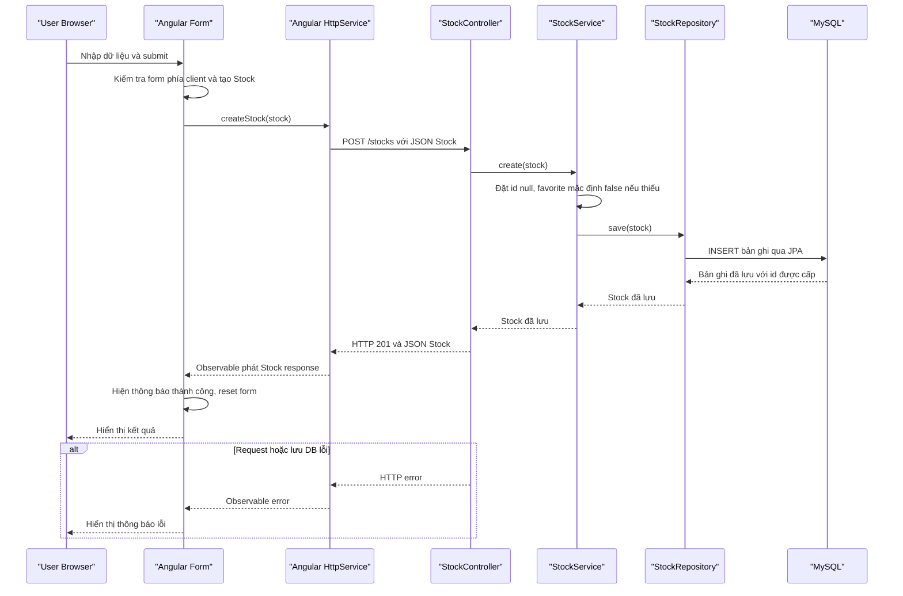

# API & Service Communication Contracts

Ứng dụng có một Angular frontend gọi REST API đồng bộ bằng `HttpClient`, và một Spring Boot API cung cấp các endpoint cho stocks và users. Luồng dữ liệu stock đi qua controller, service, Spring Data JPA repository rồi được lưu trong MySQL.

## Service Catalog

| Service | Port | Category | Purpose |
|---|---:|---|---|
| StockMarket Angular | 4200 (dev server) | Frontend | Hiển thị giao diện, kiểm tra form phía client và gọi REST API. |
| StockMarketApi | 3000 | API Layer | Cung cấp REST endpoints cho stocks/users và lưu dữ liệu qua JPA vào MySQL. |
| MySQL | 3306 | Infrastructure | Lưu trữ dữ liệu ứng dụng trong database `stockmarket`. |

## API Endpoints Inventory

| Service | Method | Path | Request Type | Response Type |
|---|---|---|---|---|
| StockMarketApi | GET | `/stocks` | Query param tùy chọn `code` | `List<Stock>`; 200 |
| StockMarketApi | POST | `/stocks` | JSON `Stock` | `Stock`; 201 |
| StockMarketApi | GET | `/stocks/{id}` | Path `id` | `Stock`; 200 hoặc 404 |
| StockMarketApi | PUT | `/stocks/{id}` | Path `id`, JSON `Stock` | `Stock`; 200 hoặc 404 |
| StockMarketApi | PATCH | `/stocks/{id}` | Path `id`, JSON patch `Stock` | `Stock`; 200 hoặc 404 |
| StockMarketApi | DELETE | `/stocks/{id}` | Path `id` | `Stock`; 200 hoặc 404 |
| StockMarketApi | GET | `/users` | Không có | `List<User>`; 200 |
| StockMarketApi | GET | `/users/{id}` | Path `id` | `User`; 200 hoặc 404 |
| StockMarketApi | POST | `/users` | JSON `User` | `User`; 201 |

Các request được gọi từ Angular `HttpService` tới `http://localhost:3000`. Endpoint POST/PUT/PATCH gửi JSON với `Content-Type: application/json`.

## Management & Observability Endpoints

Không thấy endpoint health/Actuator, Swagger hay endpoint metrics được cấu hình trong source hiện tại.

## DTOs & Contracts

Không có DTO request/response riêng được khai báo: API nhận và trả trực tiếp các entity `Stock` và `User`. Các interface TypeScript phía Angular mô tả dữ liệu frontend nhưng không phải DTO được serialize riêng ở backend. Serialization/parse JSON do Spring MVC và Angular `HttpClient` xử lý.

## Communication Patterns

- Angular gọi backend qua REST/HTTP đồng bộ; không tìm thấy message broker, giao tiếp bất đồng bộ, retry, timeout tùy chỉnh hay circuit breaker.
- `StockController` chuyển request tới `StockService`; service gọi `StockRepository` (`JpaRepository`) để đọc/ghi, JPA/Hibernate ánh xạ entity với MySQL.
- Backend cấu hình CORS cho `http://localhost:4200` và `http://127.0.0.1:4200`, cùng các method GET/POST/PUT/PATCH/DELETE/OPTIONS.
- Không có API gateway hoặc service discovery.
- Không thấy Spring Security, xác thực/ủy quyền ở backend hoặc TLS được cấu hình. Luồng login hiện tại gọi `GET /users`, sau đó lọc username/password ở Angular; đây không phải xác thực phía server.
- Một số màn hình/demo có thông báo còn nhắc `json-server`, nhưng `HttpService` trỏ `localhost:3000` và backend Spring Boot cũng cấu hình port 3000. Khi chạy thực tế cần đảm bảo chỉ API server chiếm port này.

## Service Technology Matrix

| Service | Web | Data Access | Discovery | Gateway | Health/Actuator | Cache | Metrics |
|---|---|---|---|---|---|---|---|
| StockMarket Angular | Angular, `HttpClient` | — | — | — | — | — | — |
| StockMarketApi | Spring MVC | Spring Data JPA / Hibernate | — | — | — | — | — |
| MySQL | — | MySQL | — | — | — | — | — |

## Service Communication Sequence

<!-- mermaid-checked: every participant uses `participant Id as "Label"`, no \n in aliases/messages/notes, every alt/opt/loop closed by end, no `:` inside any alias -->

